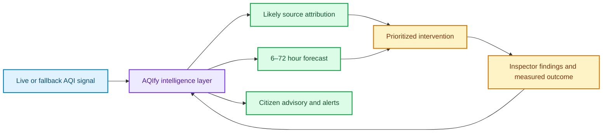

# AQIfy interview overview

## The problem

Air-quality data is useful only when it leads to a timely decision. AQIfy turns current pollutant readings and weather context into a chain of **signal → likely source → forecast → prioritized intervention → citizen guidance** for Indian cities and wards.

## Who uses it

| User | Main value | Typical actions |
|---|---|---|
| Citizen | Understand local risk and receive guidance | View AQI, choose a health profile, subscribe to alerts |
| Inspector | Execute field work | View assigned interventions, add findings, record outcomes |
| Authority | Review hotspots and create work | Run dispatch recommendations, create interventions |
| Admin | Operate the platform | Manage roles, assign inspectors, dispatch evidence packages |

## One-paragraph pitch

AQIfy is a React/Vite command center backed by FastAPI. It combines live or modeled air-quality inputs, weather, spatial emission-source metadata, a direct-horizon gradient-boosting forecaster, and four decision agents. The result is an explainable operational loop: identify a hotspot, estimate its likely sources and future trajectory, rank it using AQI plus vulnerable-receptor multipliers, dispatch an inspector, and capture findings and measured outcomes. Citizens receive profile-specific advice and optional email alerts.

## Tech stack

- **Frontend:** React 19, Vite, Leaflet, Chart.js, `fetch` API.
- **Backend:** Python, FastAPI, Uvicorn, HTTPX, SQLAlchemy.
- **Forecasting:** scikit-learn `GradientBoostingRegressor`, SciPy PCHIP interpolation, NumPy, joblib.
- **Storage:** PostgreSQL or another SQLAlchemy database through `DATABASE_URL`; local fallback is SQLite `backend/aqify.db`.
- **Acceleration:** optional Redis for JSON caching and rate limiting; process-local in-flight request maps and LRU model cache still work without Redis.
- **Integrations:** WAQI/CPCB, Open-Meteo CAMS, OpenWeather, OpenAQ, WeatherAPI/Open-Meteo weather, Gemini, and Brevo/SMTP/Resend email.

## What is real versus simulated

| Area | Current behavior |
|---|---|
| AQI/pollutants | Real provider responses when credentials and endpoints succeed; fallback sources are modeled or sensor-network data. |
| Weather | Real API data when available. |
| Emission sources | Application-configured spatial inventory used for distance weighting; this is not regulatory source apportionment. |
| Population, hospitals, schools, elderly percentage in `/api/state` | Deterministic synthetic demo metadata generated from a city-key hash (`data_quality: synthetic_demo`). |
| Forecast | ML forecast when a city model is available; otherwise Open-Meteo-derived or simple fallback output. |
| Mitigation effect | Planning simulation shown as `mitigated_aqi`; it is not a measured causal result. |
| Intervention outcome | Real workflow record only after an authorized user enters findings and before/after AQI values. |

**Interview sentence:** “The platform is real as an application and decision workflow; some inputs and impact estimates are explicitly demo or model-derived, so I label them rather than presenting them as ground truth.”
