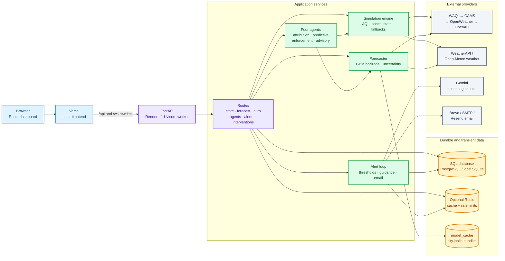

# 01. Overall system architecture

## Diagram

## Why each component exists

- **React/Vercel:** presents the map, forecasts, advisory widgets, and enforcement console. The frontend API helper sends cookies with requests and coalesces duplicate GETs.
- **FastAPI:** centralizes route registration, CORS, security headers, lifecycle startup/shutdown, and the public API.
- **Simulation engine:** normalizes external readings, calculates Indian AQI, builds city/ward state, and supplies spatial context.
- **Forecaster:** fetches historical and future inputs, trains direct-horizon models, and produces hourly forecast grids.
- **Agents:** separate analysis responsibilities so source explanation, prediction, enforcement, and citizen communication can evolve independently.
- **SQL database:** durable users, roles, locations, readings/forecasts, subscriptions, alerts, inspectors, and intervention records.
- **Redis:** an optional accelerator. A failed ping causes cache/rate-limit helpers to fail open, so Redis is not a hard runtime dependency.
- **Joblib model cache:** avoids retraining every request and lets evicted in-memory city models be reloaded or retrained.
- **Single Render worker:** avoids multiplying model memory and training work; CPU-bound fitting is bounded by a one-worker executor.

## Request-level mental model

1. The browser calls a route through Vercel’s rewrite.
2. FastAPI authenticates only where the route requires it.
3. The route reads Redis if applicable, then calls a singleton simulation/forecaster/agent service.
4. External data is normalized and returned with source, confidence, and fallback metadata where relevant.
5. Durable workflow changes are committed to SQL; transient state stays in caches.
