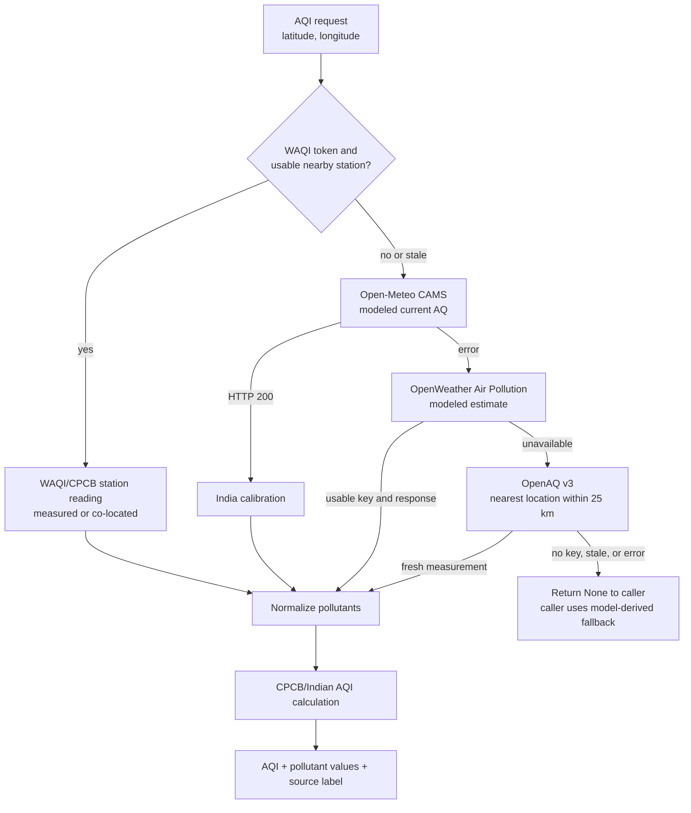

# 02. Data sources and fallback chain

## Diagram

## Executable order

The `_fetch_real_aqi` function executes this order:

1. **WAQI** geo lookup for the nearest usable CPCB/co-located station.
2. **Open-Meteo CAMS** current air-quality response, calibrated for Indian use.
3. **OpenWeather Air Pollution** modeled response.
4. **OpenAQ v3** nearest location and latest measurements, if `OPENAQ_API_KEY` exists.
5. `None`, after which callers use their own safe/model-derived fallback.

The function’s docstring currently describes OpenWeather before CAMS, but the executable branch order is CAMS before OpenWeather. Say the executable order in an interview.

## Normalization and AQI

- CAMS raw values pass through `calibrate_india_pollutants` before `calculate_indian_aqi`.
- The calibration scales NO₂, SO₂, and O₃, converts CO to mg/m³ when necessary, dampens high PM2.5, and caps PM10 relative to PM2.5 at 3.5× when both are present.
- OpenAQ missing PM values are estimated from the available PM value; measurements older than 24 hours are skipped.
- All results carry a source label such as `waqi-cpcb (live)`, `open-meteo (live)`, or `openaq-v3 (live, station: ...)`.
- `/api/state` can still contain synthetic vulnerability metadata even when its AQI is live.

## What is actually used

| Source | Code role | Credential |
|---|---|---|
| WAQI/CPCB | Highest-priority current station lookup | `WAQI_TOKEN` |
| Open-Meteo CAMS | Current and forecast AQ; historical training AQ fallback path | No key for the implemented calls |
| OpenWeather | Current, historical, and forecast AQ fallback | `OPENWEATHER_API_KEY` |
| OpenAQ v3 | Last live AQ fallback | `OPENAQ_API_KEY` |
| WeatherAPI.com | Primary future weather in `backend/ml/forecaster.py` when configured | `WEATHERAPI_KEY` |
| Open-Meteo weather | Weather fallback and historical forecast weather | No key for the implemented calls |

## Rate-limit posture

- A shared HTTPX client reuses connections and applies bounded connect/read/pool timeouts.
- Simulation and route caches reduce repeated provider calls.
- Open-Meteo batch requests are divided into batches to avoid oversized requests/timeouts.
- Redis rate limiting protects selected public/auth endpoints; if Redis is absent, the helper allows the request through.
- The README contains provider rate-limit figures, but provider quotas change. Treat those figures as planning values and verify them with each provider before presenting them as contractual limits.
