# 03. Forecasting pipeline

## Diagram

```mermaid
flowchart LR
    subgraph Train["Training per city"]
        History["Fetch 14 days hourly history"] --> AQISeries["Compute Indian AQI series"]
        AQISeries --> Features["Build features for each horizon"]
        Features --> Datasets["Targets: ΔAQI = AQI(t+h) − AQI(t)"]
        Datasets --> CV["Expanding walk-forward CV\n2 folds; persistence baseline"]
        Datasets --> Executor["Single-worker training executor"]
        Executor --> GBM["GBM point model\n6, 12, 24, 36, 48, 72 h"]
        Executor --> Q10["GBM quantile α=0.10"]
        Executor --> Q90["GBM quantile α=0.90"]
        GBM --> Bundle["Metrics + model bundle"]
        Q10 --> Bundle
        Q90 --> Bundle
        Bundle --> Disk["model_cache/city.joblib"]
    end

    subgraph Infer["Inference"]
        Now["Current AQI anchor"] --> Input["Latest history + forecast weather + future CAMS AQ"]
        Input --> Vector["Build same feature vector"]
        Disk --> Load["Load into bounded LRU cache"]
        Load --> Predict["Predict delta at anchor horizons"]
        Vector --> Predict
        Predict --> Band["Add delta to current AQI\npoint + 10/90 band"]
        Band --> PCHIP["PCHIP interpolation to hourly grid"]
        PCHIP --> Blend["Gentle CAMS blend\nML remains primary"]
        Blend --> Smooth["Clamp hourly jumps and AQI 0–500"]
        Smooth --> Anomaly["Compare current actual vs predicted\n2× residual std threshold"]
        Anomaly --> Output["Forecast grid + accuracy + anomalies"]
    end

    Disk -. persisted between requests .-> Load
```

## Training facts

- History window: **14 days** of hourly data.
- Minimum feature lookback: 24 hours; each sample also needs the selected future horizon.
- Direct horizons: **6, 12, 24, 36, 48, and 72 hours**.
- Point model: `GradientBoostingRegressor(loss="squared_error")` with 150 estimators, depth 7, learning rate 0.06, subsample 0.85, and minimum leaf size 3.
- Quantile models: the same GBM family with `loss="quantile"`, α=0.10 and α=0.90.
- CPU fitting runs through a bounded `ThreadPoolExecutor(max_workers=1)` via `run_in_executor`; this keeps the async event loop responsive and limits peak memory on the one-worker Render service.
- Model bundles are atomically persisted as `model_cache/<city>.joblib`.

## Feature groups

1. **AQI anchor/persistence:** current AQI, 1/3/6/24-hour lags, city baseline, horizon indicator.
2. **Momentum:** 1-, 3-, and 6-hour changes.
3. **Rolling statistics:** 6-hour mean/std and 24-hour mean/std/min/max.
4. **Future weather:** wind speed and direction sine/cosine, humidity, temperature, pressure, precipitation.
5. **Physical proxies:** ventilation, wind change, calm-wind flag, pressure trend, humidity change, rain washout, temperature-humidity interaction.
6. **Calendar/activity:** hour sine/cosine, weekend, morning rush, evening rush, midday.
7. **Context interactions:** rush × baseline, rush × stagnation, rush × weekday, calm × night.

## Why delta targets?

The model learns **change from the current AQI**, rather than relearning the absolute city level at every horizon. That makes persistence a natural baseline, anchors predictions to the latest reading, and lets weather and rush-hour features explain the direction and size of movement. The implementation clamps implausible deltas and final values to 0–500.

## Why GBM instead of an LSTM?

This feature set is tabular, mixed-type, and relatively short at 14 days. GBM handles nonlinear interactions, missing/defaulted inputs, and small-to-medium datasets without sequence-model infrastructure. It is easier to train within a single Render worker, easier to inspect and benchmark against persistence, and less operationally expensive than an LSTM. An LSTM could be a future experiment if there were a much larger, stable, station-level history.

## Uncertainty, baseline, and evaluation

- Quantile regressors provide lower and upper AQI bands; the route enforces `low ≤ point ≤ high`.
- `skill_score = 1 − ml_mae / max(1, persistence_mae)`.
- Persistence predicts no change from the current AQI. It is hard to beat in slowly changing conditions, so it is a meaningful baseline.
- Walk-forward expanding windows preserve time order and avoid training on future observations. Two folds are a resource-conscious compromise; the fallback is a single 75/25 split when a dataset is too small.
- The route adds an anomaly when actual current AQI differs from the forecast by more than `2 × residual_std`; the severity becomes critical above `3 × residual_std`.

## Fallbacks

If a model is missing, training is scheduled in the background and the request returns an Open-Meteo-derived forecast when its inputs are available. If those inputs fail too, the forecaster returns a simple persistence/diurnal fallback and labels its `model_type` accordingly.
