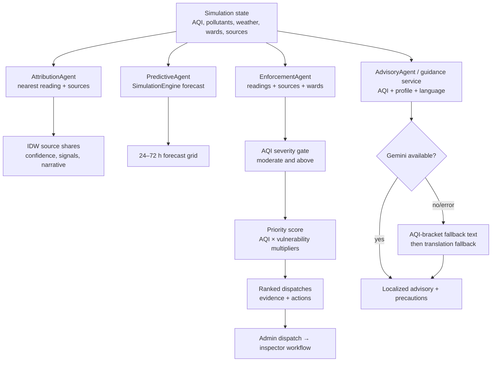

# 04. Multi-agent intelligence

## Diagram

## Attribution agent

1. Select the nearest reading to the requested coordinate.
2. Read pollutant and weather values.
3. For each known source within 10 km, calculate `1 / distance` and multiply by a pollutant-signature boost.
4. Normalize category weights into percentages and attach a confidence derived from the share.

Heuristics implemented in `backend/agents/agents.py`:

- **NO₂ > 40 or CO > 1.0:** boost vehicular traffic.
- **SO₂ > 20, or PM2.5 > 50 with SO₂ > 10:** boost industrial emissions.
- **PM10 / PM2.5 > 1.8 and PM10 > 50:** boost construction/road dust.
- **PM2.5 / PM10 > 0.6 and PM2.5 > 60:** boost waste/crop burning.

The output is evidence-weighted planning attribution, not a regulatory chemical source-apportionment study.

## Predictive agent

The `PredictiveAgent` is a thin adapter that delegates to the simulation/forecast engine. The richer ML path is in `backend/ml/forecaster.py`; it returns point forecasts, uncertainty bands, accuracy metrics, persistence baseline, mitigation estimate, and anomalies.

## Enforcement agent

Only readings at or above AQI 101 enter the hotspot list. Severity buckets are:

| AQI | Severity |
|---:|---|
| 101–200 | moderate |
| 201–300 | poor |
| 301–400 | very_poor |
| 401–500 | severe |

Priority starts at AQI and applies the available vulnerability multipliers:

- hospitals ≥ 3: ×1.30;
- schools ≥ 5: ×1.15;
- elderly population ≥ 15%: ×1.20.

Each dispatch includes dominant pollutant, exceedances, inferred sources, nearby sources within 5 km, vulnerability flags, evidence fields, and context-specific recommendations for pollution-control boards, municipal bodies, traffic police, health facilities, or schools.

## Advisory agent

Advisory inputs are ward, AQI, pollutant averages, weather, source context, language, and health profile. Profiles include healthy adult, sensitive group, elderly, outdoor worker, and asthma/respiratory condition. Dynamic guidance asks Gemini for exactly three precautions and falls back to static AQI brackets plus translation if Gemini is absent or fails.

The health-assistant and guidance service define nine language codes: **English, Hindi, Kannada, Tamil, Telugu, Malayalam, Marathi, Gujarati, Bengali**. The structured legacy `AdvisoryAgent` table currently has built-in entries for the first five; the service-level Gemini/translation path covers all nine.
