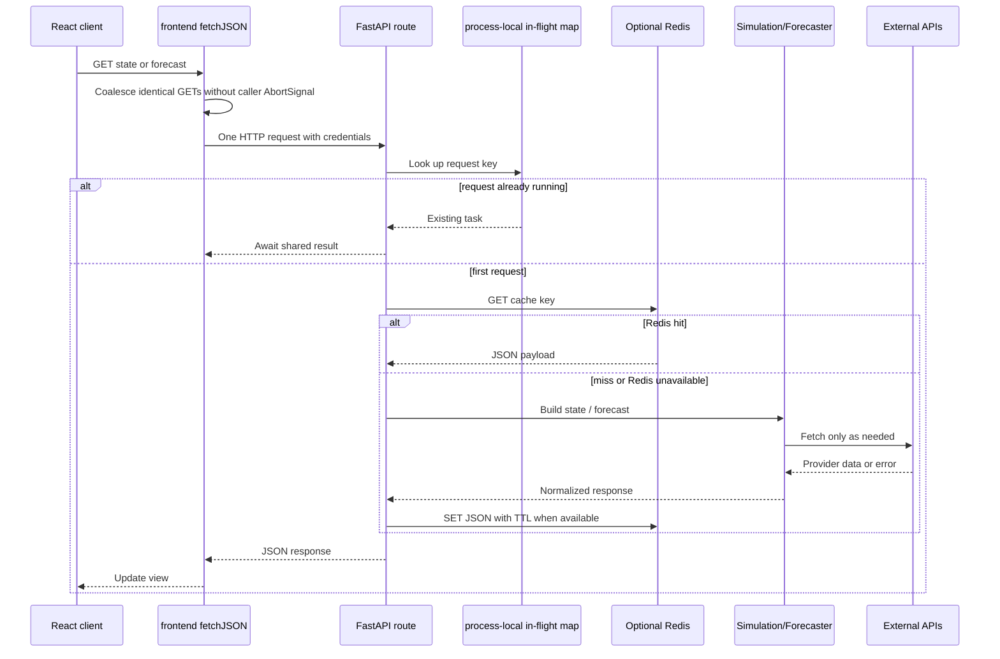

# 05. Caching and performance

## `/api/state` and `/api/forecast` flow

## Cache policy

| Layer | Key | TTL / bound | Failure behavior |
|---|---|---:|---|
| Frontend GET coalescing | method + API + path | Until request settles | Caller-owned abort signals are not shared |
| `/api/state` Redis | `state:<city>` | 180 seconds | Miss and rebuild; route continues if Redis is down |
| `/api/forecast` Redis | `forecast:<city>:<hours>` | 240 seconds | Miss and rebuild; route continues if Redis is down |
| Route coalescing | city/fresh or city/hours/fresh | Until task settles | Prevents duplicate concurrent work in one process |
| Simulation engine | Internal state/forecast keys | Configured local TTL | Provider fetch or fallback |
| Forecaster models | OrderedDict by city | `MODEL_CACHE_MAX_CITIES`, default 4 | LRU eviction; persisted joblib remains |
| Advisory/translation | Process-local ordered caches | Configured max entries | Regenerate or translate again |

`fresh=true` bypasses the Redis read for the relevant route, but it does not remove the stored entry automatically.

## Why Redis is optional

Redis is an accelerator, not a correctness dependency. `get_redis_client()` pings with short timeouts; cache errors return a miss, and the rate-limit helper allows requests when Redis is unavailable. This keeps a Render deployment with only the web service usable, at the cost of more provider work and no cross-instance shared cache.

## Training performance

- Startup training is disabled by default on Render and can be enabled explicitly.
- Training is serialized through a one-worker executor to keep peak memory predictable.
- The async event loop is not blocked by synchronous sklearn fitting.
- `train_for_city` deduplicates concurrent training for the same city.
- Historical/network work runs outside the model-cache lock.
- A shared HTTPX client uses connection pooling and bounded timeouts.

## What to say about scaling

The current design is optimized for one web worker and modest traffic. For multiple backend instances, Redis should become a real shared cache and a distributed job queue/lock should coordinate training and alert work. The current process-local in-flight maps do not coalesce requests across processes.
