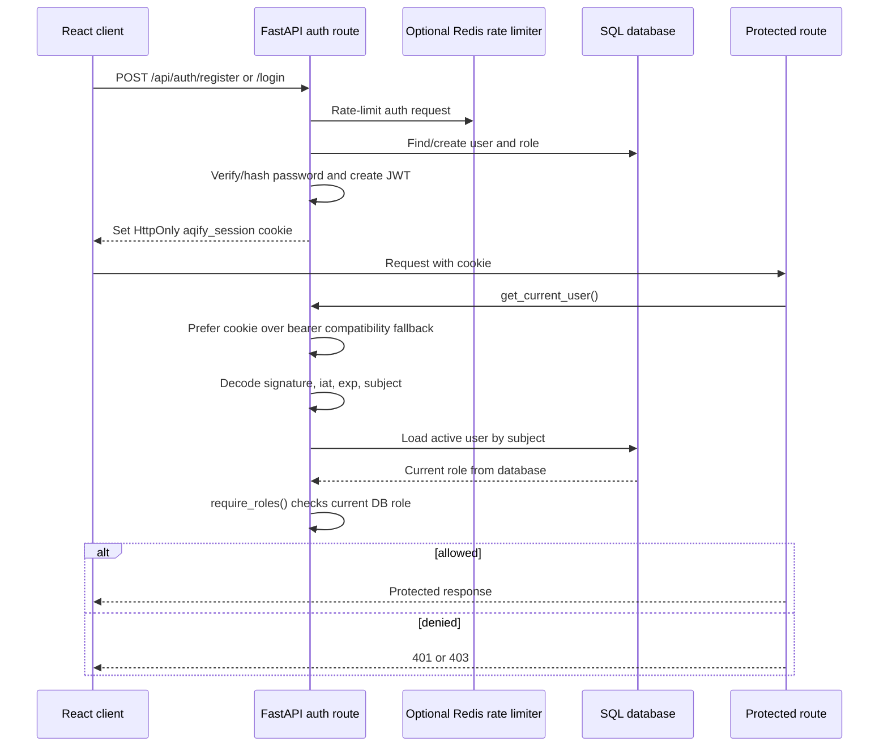

# 06. Authentication and RBAC

## Diagram

## Authentication behavior

- Passwords are hashed with Passlib (`pbkdf2_sha256`, with bcrypt compatibility).
- JWTs use HS256, contain `sub`, `role`, `iat`, and `exp`, and default to 120 minutes.
- The token is stored in the `aqify_session` cookie with `HttpOnly`; production also uses `Secure` and `SameSite=None` because the frontend and backend are separate origins.
- `get_current_user` prefers the cookie. An `Authorization: Bearer` token remains supported for older clients.
- The role claim is not trusted for authorization by itself. The user is reloaded from SQL and `require_roles` checks the current relationship to `Role` on every protected request.
- Public registration can create **Citizen** only. Elevated roles are provisioned by an admin or reserved environment-configured accounts.

## Role matrix

| Capability | Citizen | Inspector | Authority | Admin |
|---|:---:|:---:|:---:|:---:|
| Register/login/profile | ✓ | ✓ | ✓ | ✓ |
| Public state, forecasts, advisory, alerts | ✓ | ✓ | ✓ | ✓ |
| View enforcement dashboard |  | ✓ | ✓ | ✓ |
| Run `/api/agents/dispatch` |  | ✓ | ✓ | ✓ |
| Create location/intervention |  |  | ✓ | ✓ |
| Dispatch inspector |  |  |  | ✓ |
| Manage roles/users |  |  |  | ✓ |
| Update assigned intervention |  | Own assignment | ✓ | ✓ |
| Add findings/outcome |  | Own assignment | ✓ | ✓ |
| Clear caches |  |  |  | ✓ |

## Cookie versus bearer token

The HttpOnly cookie is the default for the browser because JavaScript cannot read it, reducing exposure to token theft through ordinary local-storage access. `credentials: include` and explicit production CORS are required. The bearer fallback is useful for scripts and older clients, but it must be treated like any other bearer secret and sent only over HTTPS.
