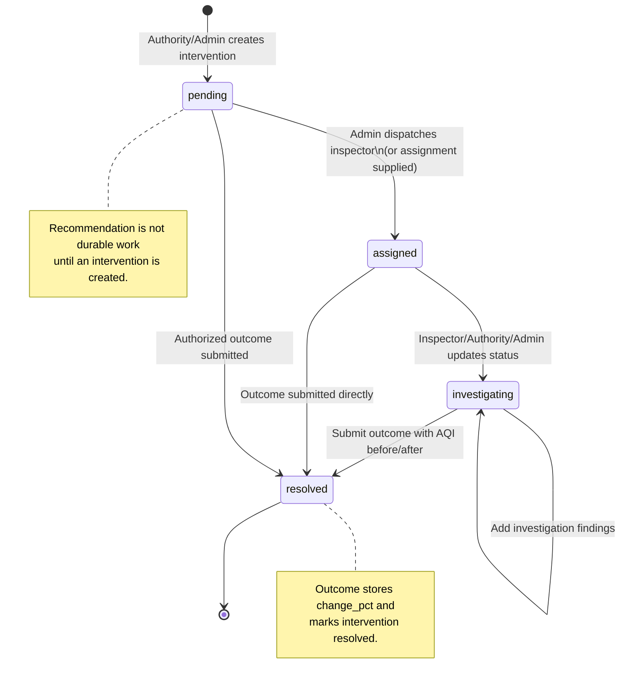

# 07. Intervention lifecycle

## Diagram

## Lifecycle in the application

1. **Recommendation:** `EnforcementAgent` returns a ranked hotspot with evidence and recommended actions. This is an analysis response, not yet a database intervention.
2. **Admin dispatch:** `/api/interventions/dispatch` persists the evidence package, selects an explicit or first active inspector, and creates status `assigned`.
3. **Inspector assignment:** an inspector sees only interventions assigned to that inspector. Authority and Admin users can see all.
4. **Investigation:** the assigned inspector, Authority, or Admin can set `investigating` and add `InvestigationFinding` text.
5. **Outcome:** the authorized user submits before/after AQI, intervention type, suspected source, location, and findings. The API calculates `change_pct` and marks the parent intervention `resolved`.

## Data captured

- Location and coordinates.
- AQI and severity at creation time.
- Priority score and suspected source.
- Human-readable description and recommendation/evidence package.
- Assigned inspector.
- Findings, actor, and timestamp.
- Outcome AQI before/after, percentage change, intervention type, source, resolution date, and inspector findings.

## Authorization details

- Authority/Admin can create interventions; only Admin can explicitly dispatch an inspector through the evidence-dispatch endpoint.
- An Inspector may update, add findings to, or resolve only their own assigned intervention.
- Authority/Admin may operate any intervention.
- The enum accepts `pending`, `assigned`, `investigating`, and `resolved`. The current route validates that the requested value is in the enum but does not enforce a strict predecessor transition, so the state diagram describes intended workflow rather than a database-enforced state machine.
