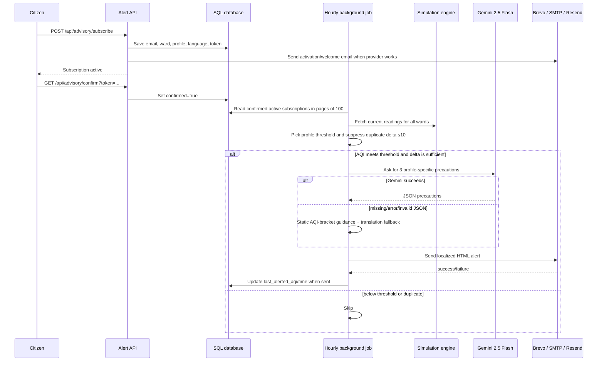

# 08. Alerts and citizen advisory

## Diagram

## Profile thresholds

| Profile | Alert threshold |
|---|---:|
| Asthma | AQI 50 |
| Sensitive group | AQI 100 |
| Elderly | AQI 100 |
| Outdoor worker | AQI 100 |
| Healthy adult | AQI 150 |

An alert is also suppressed when the current AQI differs from the last alerted value by 10 points or less, except for the first alert. Subscriptions are processed in bounded pages, and an email failure is retried on a later loop because the last-alerted value is not advanced.

## Confirmation behavior: important interview nuance

The API has `/api/advisory/confirm`, a confirmation token, and a confirmed flag. However, the current public `/api/advisory/subscribe` route creates or updates subscriptions with `confirmed=True` immediately and sends an activation email. Therefore the deployed behavior is **auto-confirmed**, not a strict double opt-in. Describe the confirm endpoint as present but identify auto-confirmation as a known gap.

## Advisory and language support

- Profiles: asthma/respiratory condition, sensitive group, elderly, outdoor worker, healthy adult.
- Guidance is generated by Gemini when `GEMINI_API_KEY` is configured.
- Missing key, provider error, invalid response, or translation failure falls back to static profile-specific advice.
- Guidance service and health assistant map nine languages: **English (`en`), Hindi (`hi`), Kannada (`kn`), Tamil (`ta`), Telugu (`te`), Malayalam (`ml`), Marathi (`mr`), Gujarati (`gu`), Bengali (`bn`)**.
- The email includes AQI category, trend since the last alert, pollutant breakdown, profile guidance, dashboard link, and unsubscribe link.

## Email provider order

`_send_email` tries Brevo HTTP API, then configured SMTP, then Resend, and finally logs a console simulation and returns failure if no sender is configured.
