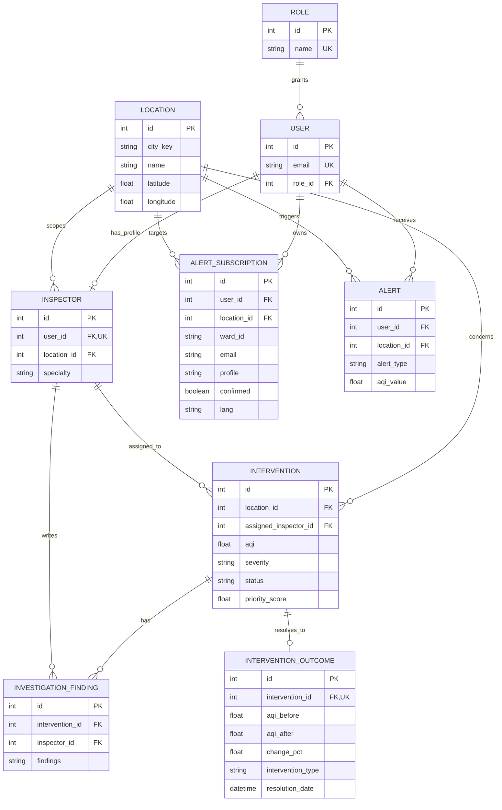

# 09. Database and persistence

## ER diagram

## Modeling notes

- `Location` is the shared geographic parent for subscriptions, alerts, inspectors, and interventions.
- `AlertSubscription` supports both authenticated user/location subscriptions and public email/ward subscriptions; `user_id` and `location_id` are nullable in the current model.
- `InterventionOutcome` is one-to-one with `Intervention`; multiple `InvestigationFinding` rows are allowed.
- Constraints protect AQI ranges, valid coordinates, and intervention priority values.
- In local development, `backend/core/database.py` defaults to `backend/aqify.db`; deployment should use `DATABASE_URL`. `init_db()` calls `create_all`, removes retired reading/forecast tables, and contains a SQLite compatibility shim.

## Active tables

The active schema is `roles`, `users`, `locations`, `alert_subscriptions`, `inspectors`,
`interventions`, `investigation_findings`, `intervention_outcomes`, and optional `alerts`.
AQI readings and forecasts are fetched or computed on demand and are not persisted.
