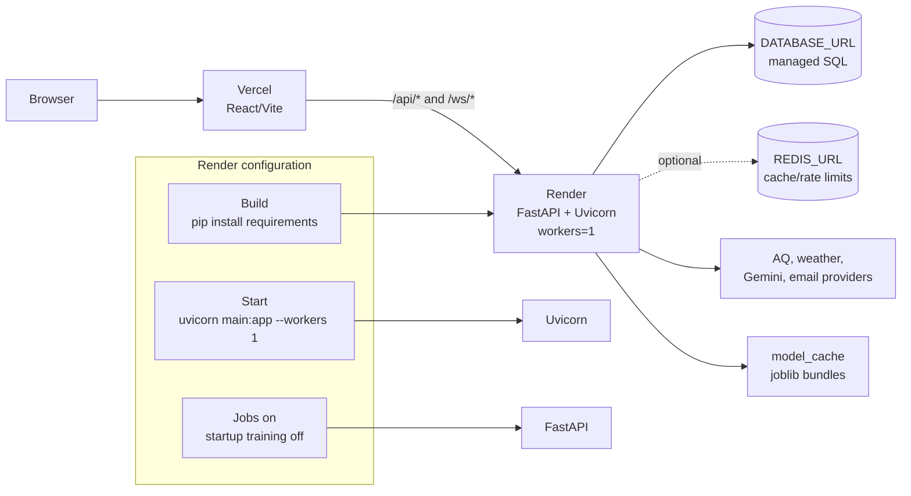

# 10. Deployment

## Diagram

## Current hosting shape

- `render.yaml` defines one standard Render Python web service.
- Build: `pip install -r backend/requirements.txt`.
- Start: `cd backend && uvicorn main:app --host 0.0.0.0 --port $PORT --workers 1`.
- `ENABLE_BACKGROUND_JOBS=true` starts the hourly alert loop.
- `ENABLE_STARTUP_TRAINING=false` avoids duplicate memory-heavy work during startup; a request can still warm a city model in the background.
- Health checks are available at `GET /health` (and the backwards-compatible `GET /api/health`). Configure the hosting provider to probe `/health`; both endpoints return the database and optional Redis status.
- `frontend/vercel.json` rewrites `/api/*` to `https://aqify.onrender.com/api/*` and `/ws/*` to `wss://aqify.onrender.com/ws/*`.
- The backend can serve `frontend/dist` when the built frontend is present, but the intended split deployment is Vercel frontend plus Render API.

## Environment variables

### Required or production-critical

| Variable | Purpose |
|---|---|
| `DATABASE_URL` | SQLAlchemy database URL; use managed PostgreSQL in deployment. |
| `JWT_SECRET` | Random secret, at least 32 characters in production. |
| `CORS_ORIGINS` | Explicit comma-separated frontend origins in production. |
| `DEFAULT_INSPECTOR_PASSWORD` | Reserved inspector account password in production. |
| `PUBLIC_BASE_URL` | Public URL used in alert links. |

### Integrations and optional tuning

| Variable | Purpose |
|---|---|
| `WAQI_TOKEN` | WAQI/CPCB station access. |
| `OPENWEATHER_API_KEY` | OpenWeather fallback and forecast/history calls. |
| `OPENAQ_API_KEY` | OpenAQ v3 fallback. |
| `WEATHERAPI_KEY` | Optional primary future-weather provider. |
| `REDIS_URL` | Optional cache/rate-limit Redis. |
| `GEMINI_API_KEY` | Dynamic health guidance and health assistant. |
| `BREVO_API_KEY`, `BREVO_SENDER_EMAIL` | Brevo email provider. |
| `SMTP_HOST`, `SMTP_PORT`, `SMTP_USER`, `SMTP_PASSWORD`, `SMTP_FROM` | SMTP provider. |
| `RESEND_API_KEY`, `RESEND_FROM_EMAIL` | Resend provider. |
| `APP_ENV` | Development/production behavior. |
| `ALERT_LOOP_INTERVAL` | Alert loop interval in seconds; default 3600. |
| `STARTUP_TRAIN_CITIES` | Comma-separated parent cities for optional startup training. |
| `MODEL_CACHE_MAX_CITIES` | In-memory model LRU capacity; Render sets 4. |
| `AQI_MODEL_CACHE_DIR` | Persisted model directory override. |
| `SIMULATION_CACHE_MAX_ENTRIES`, `ADVISORY_CACHE_MAX_ENTRIES`, `TRANSLATION_CACHE_MAX_ENTRIES` | Process-local cache limits. |
| `ENABLE_BACKGROUND_JOBS`, `ENABLE_STARTUP_TRAINING` | Lifecycle switches. |

## Deployment answer

“Vercel serves the static React app and rewrites API/WebSocket paths to a single-worker FastAPI service on Render. SQL is durable and configured through `DATABASE_URL`; Redis is optional. I deliberately disable startup training in the small web instance and use background, deduplicated, one-worker model fitting instead.”
