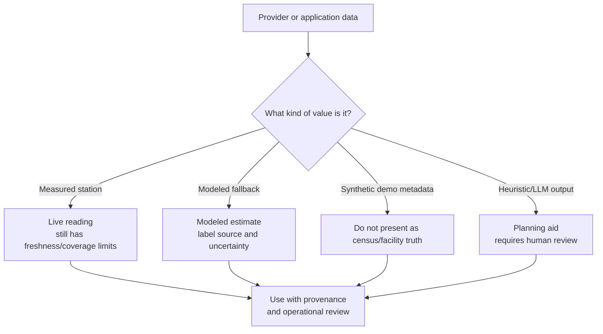

# 12. Known limitations and interview honesty checklist

## Data quality and modeling gaps

1. **Synthetic vulnerability fields:** `/api/state` derives population, hospital, school, and elderly values from a city-key hash. They are deterministic demo values, not a census or facility registry.
2. **Source attribution is heuristic:** IDW plus pollutant signatures is useful for prioritization but not regulatory source apportionment. The inventory is application-configured and may not represent every source.
3. **CAMS/OpenWeather/OpenAQ fallbacks are not equivalent:** a modeled estimate or distant sensor should be shown with different confidence from a nearby ground station.
4. **Forecast history is short:** training uses 14 days, which limits seasonal and rare-event learning. A longer, quality-controlled historical archive would be stronger.
5. **Validation is limited:** walk-forward CV uses two folds under current resource constraints. There is no documented city-by-city benchmark report or interval-coverage report in the repository.
6. **Quantile bands are model outputs, not calibrated guarantees:** they should be checked for empirical coverage before being described as formal confidence intervals.
7. **Mitigation is simulated:** `mitigated_aqi` is a planning estimate from weather/time factors, not observed causal impact. Recommendations should not promise a specific reduction.
8. **Fallback forecast can be synthetic:** when live forecast inputs and trained models fail, the final fallback includes a simple diurnal pattern and noise. Its `model_type` should be surfaced prominently.

## Workflow and product gaps

9. **Alert confirmation is not strict double opt-in:** the subscribe route currently marks the subscription confirmed immediately, although a confirm route/token exists.
10. **Intervention transitions are not enforced as a strict state machine:** the API validates enum values but permits broad status jumps for authorized users.
11. **WebSocket is not the current dashboard transport:** `/ws/aqi` accepts connections and can broadcast manual refresh payloads, but `App.jsx` uses polling for state refresh.
12. **Hourly work is process-local:** the alert loop starts inside the web process. Multiple backend instances could duplicate sends unless a distributed scheduler/lock is added.
13. **Training is process-local:** the in-flight set and LRU cache do not coordinate across workers or instances. Render is intentionally configured with one worker today.
14. **Redis failure is fail-open:** availability is preserved, but cache misses increase provider traffic and rate-limit protection disappears.
15. **Email delivery is best-effort:** provider credentials, sender verification, sandbox rules, and recipient deliverability can prevent delivery.
16. **Language coverage differs by path:** the guidance service and health assistant list nine languages, while the structured legacy `AdvisoryAgent` built-in table currently lists five. Dynamic translation/Gemini fills the broader path, but it should not be described as equally native in every code path.

## Documentation and repository gaps

17. **README drift:** it describes `subscriptions.db`/SQLite and Open-Meteo as the main source, while the current application uses SQLAlchemy with `DATABASE_URL`, Alembic migrations, and attempts WAQI first.
18. **The generic `web-request-cache-miss.sequence.json` is not the application flow:** it should not be used as the architecture diagram.
19. **`backend/ml/simulation.py` is very large:** it is easy for duplicated provider/calibration logic to drift. Centralizing adapters and adding contract tests would reduce that risk.
20. **Provider quotas are external:** rate-limit numbers in README are planning references, not guarantees. Check current provider terms before claiming them.

## Security checklist before an interview or public demo

- Inspect `backend/.env` and `git log` for Gemini, OpenWeather, WAQI, SMTP, Resend/Brevo keys, database URLs, and default passwords.
- Rotate any credential that may have been exposed, even if it was later redacted locally.
- Confirm `.env`, local databases, model artifacts, logs, and generated build files have the intended Git ignore policy.
- Set production `JWT_SECRET`, explicit `CORS_ORIGINS`, and all reserved-account passwords through the deployment secret manager.
- Avoid putting credentials, tokens, or live recipient addresses into screenshots and interview diagrams.

## The honest closing answer

“This is a working decision-support prototype with real provider integrations, durable role/workflow records, and explicit fallbacks. It is not yet a regulatory monitoring system: some vulnerability metadata is synthetic, source attribution is heuristic, forecast intervals need calibration, and background jobs assume one worker. Those are the next engineering and validation steps.”
